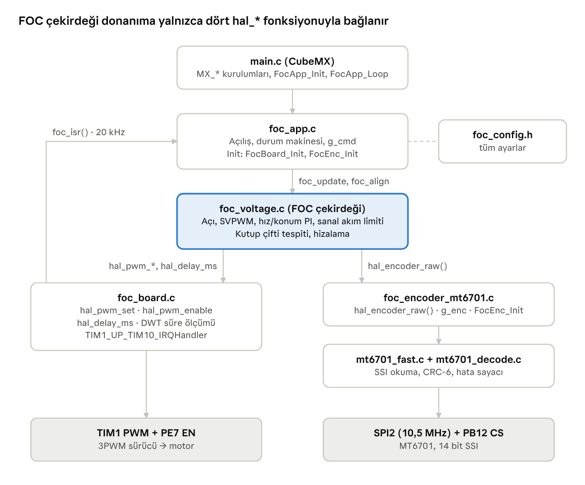
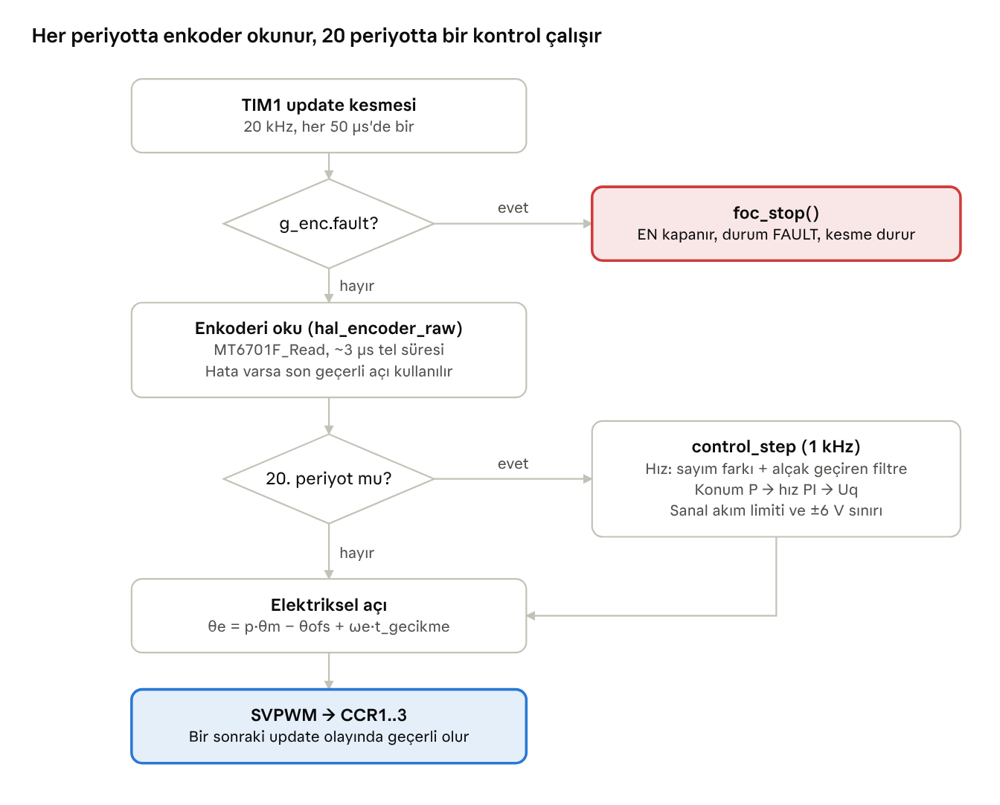
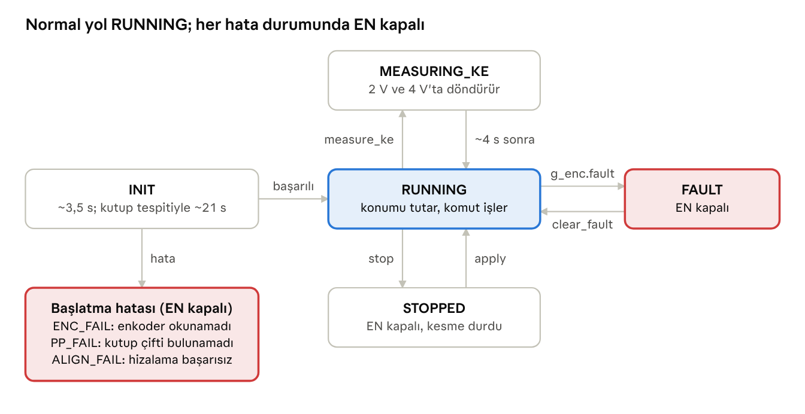

# FOC ve MT6701 Enkoder Yazılımı – Teknik Doküman

2026-11-19

STM32F407 üzerinde, akım sensörü olmadan, MT6701 14 bit mutlak manyetik enkoderle bir gimbal BLDC motorunu voltaj modlu FOC ile süren yazılımı anlatır. Kod `VoltageFOC` projesinin `Core/` klasöründedir; tüm değerler 19 Kasım 2026 sürümüne göredir.

## 1. Mimari

Yazılım dört katmandan oluşur: uygulama (`foc_app`), FOC çekirdeği (`foc_voltage`), kart katmanı (`foc_board`) ve enkoder sürücüsü (`mt6701_*`). FOC çekirdeği donanımdan bağımsızdır; donanıma yalnızca dört `hal_*` fonksiyonu üzerinden erişir. Bu sayede aynı çekirdek PC simülasyonunda değiştirilmeden test edilir.



*Modül mimarisi · 4 yazılım katmanı, 2 donanım yolu*

Oklar çağrı yönünü gösterir. Tek ters yönlü ok, `foc_board.c`'deki TIM1 kesmesinin her periyotta `foc_app.c`'deki `foc_isr()` geri çağrısını tetiklemesidir.

| Dosya                     | Katman        | Görev                                                                                                   |
|---------------------------|---------------|---------------------------------------------------------------------------------------------------------|
| `main.c`                  | CubeMX        | Saat, GPIO, SPI2, TIM1 HAL kurulumu; USER CODE içinde `FocApp_Init()` ve `FocApp_Loop()` çağrıları      |
| `foc_app.c/.h`            | Uygulama      | Açılış sırası, durum makinesi, komutlar (`g_cmd`), Ke ölçümü, hata kurtarma                             |
| `foc_config.h`            | Uygulama      | Tüm ayarlanabilir parametreler                                                                          |
| `foc_voltage.c/.h`        | FOC çekirdeği | Elektriksel açı, ters Park/Clarke, SVPWM, hız/konum döngüleri, kutup çifti tespiti, hizalama            |
| `foc_board.c/.h`          | Kart          | TIM1 PWM (PE9/PE11/PE13), EN (PE7), 20 kHz kesme, ISR süre ölçümü, `hal_pwm_set/enable`, `hal_delay_ms` |
| `foc_encoder_mt6701.c/.h` | Adaptör       | `hal_encoder_raw()`; `g_enc` nesnesi; `FocEnc_Init()`                                                   |
| `mt6701_fast.c/.h`        | Enkoder       | SPI2 register seviyesinde SSI okuma, doğrulama, hata sayacı                                             |
| `mt6701_decode.c`         | Enkoder       | Saf çözümleme ve CRC-6 (PC'de test edilebilir)                                                          |
| `foc_test/`               | Test          | PC simülasyonları; firmware'e derlenmez                                                                 |

`mt6701.c/.h` eski polling sürücüsüdür. Projede derlenir ama hiçbir yerden çağrılmaz.

## 2. Donanım ve pin eşlemesi

MCU STM32F407VG, 8 MHz HSE ve PLL ile 168 MHz çalışır. APB1 42 MHz (SPI2), APB2 84 MHz'dir; APB2 zamanlayıcı saati 168 MHz olduğu için TIM1 168 MHz ile sayar.

| Sinyal        | Pin  | Çevre birimi          | Ayar                                                          |
|---------------|------|-----------------------|---------------------------------------------------------------|
| Faz A PWM     | PE9  | TIM1_CH1, AF1         | Push-pull, very high speed                                    |
| Faz B PWM     | PE11 | TIM1_CH2, AF1         | Push-pull, very high speed                                    |
| Faz C PWM     | PE13 | TIM1_CH3, AF1         | Push-pull, very high speed                                    |
| Sürücü EN     | PE7  | GPIO çıkış (`FOC_EN`) | Aktif yüksek, açılışta Low. Bu kurulumda sürücüye bağlı değil |
| MT6701 CLK    | PB13 | SPI2_SCK, AF5         | 10,5 MHz, CPOL=1                                              |
| MT6701 DO     | PB14 | SPI2_MISO, AF5        | —                                                             |
| (kullanılmaz) | PB15 | SPI2_MOSI, AF5        | 0xFF gönderilir; MT6701'in girişi yok                         |
| MT6701 CSN    | PB12 | GPIO çıkış (`CS`)     | Yazılımla sürülür, açılışta High                              |

**Sürücü:** 3PWM girişli bir sürücü kullanılıyor. Dead-time sürücünün içinde olduğu için TIM1 dead-time 0 ve tamamlayıcı çıkışlar kapalıdır. Bu kurulumda yalnızca üç PWM hattı ve GND bağlıdır; sürücünün EN girişi PE7'ye bağlı değildir.

Bunun sonucu: kodun “EN kapalı” dediği durumlarda (FAULT, STOPPED, başlatma hataları) sürücü çıkışları boşa alınmaz. Üç PWM 0'a çekildiği için üç faz da düşük tarafa bağlanır, motor sargıları kısa devre olur ve motor elle çevrilmeye direnç gösterir. Bu güvenli bir durumdur; akım yalnızca motor elle döndürülürse oluşur. EN girişli bir sürücüye geçilirse EN → PE7 bağlanmalı, DRV8313 gibi entegrelerde nSLEEP ve nRESET de yüksekte tutulmalıdır. Sürücü 6PWM tipindeyse (her faz için ayrı high/low girişi) yalnızca 3 PWM bağlamak yeterli değildir.

**Motor:** Gimbal BLDC, Vbus 12 V. Faz direnci iki uç arasında 26 Ω ölçüldü, yıldız bağlantı varsayımıyla faz direnci 13 Ω alındı. Kutup çifti sayısı 7'dir: 19 Kasım kart testinde otomatik tespitle bulundu (pp_est 6,99) ve FOC_POLE_PAIRS ayarına yazıldı.

**CubeMX notu:** TIM1, PE7 ve PB12 `.ioc` dosyasında tanımlıdır, ama TIM1 kesmesi CubeMX'te **kapalı** bırakılmalıdır. Kesme fonksiyonu `foc_board.c`'de tanımlıdır; CubeMX'te açılırsa aynı fonksiyon iki kez tanımlanır ve link hatası alınır. `FocBoard_Init()` TIM1 ve pinleri CubeMX'le aynı değerlere registerlarla yeniden yazar; ikisi çelişirse kodun değerleri geçerli olur.

## 3. Zamanlama

FOC, TIM1'in 20 kHz'lik güncelleme kesmesinde çalışır: açı ve PWM her 50 µs'de, hız ve konum kontrolü 20 periyotta bir (1 kHz) güncellenir.



*Bir PWM periyodunda kesme akışı · 2 karar, 6 adım*

TIM1 merkez hizalı modda 0'dan 4200'e ve geri sayar; bir PWM periyodu 2 · 4200 / 168 MHz = 50 µs sürer. Repetition Counter (RCR) = 1 olduğu için güncelleme olayı iki yarım periyotta bir, yani her PWM periyodunda bir kez gelir. CCR registerleri preload'lu olduğundan kesmede yazılan duty değerleri bir sonraki güncelleme olayında devreye girer; `FOC_LATENCY_S` bu gecikmeyi karşılar.

| İş                                                         | Bağlam                  | Sıklık           |
|------------------------------------------------------------|-------------------------|------------------|
| Enkoder okuma, elektriksel açı, SVPWM                      | TIM1 kesmesi            | 20 kHz           |
| Hız, konum/hız PI, sanal akım limiti                       | TIM1 kesmesi            | 1 kHz            |
| Komut işleme, Ke ölçümü (`FocApp_Loop`)                    | Ana döngü               | ~500 Hz          |
| Hizalama (FOC_POLE_PAIRS = 0 ise önce kutup çifti tespiti) | Ana döngü, kesme kapalı | Açılışta bir kez |

En kötü kesme süresi 19 Kasım kart testinde ölçüldü: `g_isr_cycles_max` = 5626 çevrim, yani **33,5 µs**. Bu, 50 µs'lik periyodun %67'sidir; bütçeye sığar ama geniş bir pay bırakmaz. Değer, `foc_board.c`'nin her kesmede DWT çevrim sayacıyla tuttuğu süredir (`g_isr_cycles_max / 168` = µs). Enkoder çerçevesi 10,5 MHz'de bunun yalnızca ~3 µs'sidir; kalanın büyük kısmının sinüs, kosinüs ve açı sarma (`fmodf`) hesaplarından geldiği düşünülüyor, ayrıca ölçülmedi. Proje `-Os` ile derleniyor. Sistem büyürse bu hesaplar hızlı yaklaşımlarla değiştirilerek süre kısaltılabilir.

Ana döngüdeki `HAL_Delay(1)`, HAL'ın her beklemeye bir tick eklemesi nedeniyle 1–2 ms bekler; bu yüzden `FocApp_Loop` yaklaşık 500 Hz'de çalışır. Motor kontrolü tamamen kesmede olduğu için bu yeterlidir.

## 4. MT6701 enkoder sürücüsü

Sürücü, açıyı her PWM periyodunda bir kez SSI üzerinden yaklaşık 4–5 µs'de okur, CRC ve durum bitlerini doğrular ve yalnızca geçerli açıyı FOC'a verir. HAL kullanmaz; bekleme döngüleri sayıyla sınırlıdır, SysTick'e bağlı değildir. Bu yüzden kesme içinde kilitlenmez.

### 4.1 SSI çerçevesi

MT6701 datasheet'ine göre (Rev 1.5, s. 23–24) çerçeve 24 bittir ve MSB önce gelir:

| Bitler | Alan       | Açıklama                                                                                                               |
|--------|------------|------------------------------------------------------------------------------------------------------------------------|
| 14     | D\[13:0\]  | Açı; 16384 sayım/tur, 0,022°/LSB                                                                                       |
| 4      | Mg\[3:0\]  | Mg\[1:0\]: 0 normal, 1 alan çok güçlü, 2 alan çok zayıf, 3 tanımsız. Mg\[2\]: buton. Mg\[3\]: iz kaybı (loss of track) |
| 6      | CRC\[5:0\] | x⁶+x+1, açı ve Mg'nin 18 biti üzerinden                                                                                |

CLK boşta yüksektir, DO yükselen kenarda değişir ve düşen kenarda okunmalıdır. Bu, SPI **mod 2**'dir (CPOL=1, CPHA=1Edge). CSN düştükten sonraki ilk düşen kenarda DO henüz sürülmemiş olduğundan bir boş bit gelir. Bu yüzden 32 saat darbesi gönderilir ve paket şöyle çıkarılır:

```c
raw32  = rx0<<24 | rx1<<16 | rx2<<8 | rx3;
packet = (raw32 >> 7) & 0xFFFFFF;   /* bit31 boş bit, son 7 bit atılır */
angle  = (packet >> 10) & 0x3FFF;
mg     = (packet >> 6)  & 0xF;
crc    =  packet        & 0x3F;
```

Datasheet'teki zamanlama şekli boş bit konusunda net değildir. Doğrulaması CRC'dir: hizalama yanlış olsaydı CRC hemen her okumada tutmazdı. Sahada `g_enc.crc_err` sıfıra yakın kalmalıdır.

### 4.2 CRC-6

Polinom x⁶+x+1 (0x43), başlangıç değeri 0, MSB önce. Datasheet başlangıç değerini vermez; 0 değeri kullanıcının önceki çalışan kodundan alındı. Hesap 64 girişli bir tabloyla, 18 biti üç adet 6 bitlik parça halinde işler. Tablo, bit bit hesapla ve bağımsız bir uzun bölme referansıyla 2¹⁸ girişin tamamında karşılaştırıldı.

### 4.3 Okuma sırası (`MT6701F_Read`)

1.  SPI'de bekleyen eski RXNE/OVR bayraklarını DR ve SR okuyarak temizle.

2.  CS'yi düşür (BSRR), 20 NOP bekle (≥100 ns kurulum süresi için, yaklaşık 120 ns).

3.  Dört kez: TXE bekle, DR'ye 0xFF yaz, RXNE bekle, baytı oku.

4.  BSY'nin sıfırlanmasını bekle, 10 NOP bekle (≥0,5 Tclk tutma süresi), CS'yi yükselt.

5.  Herhangi bir bekleme 500 turu aşarsa CS'yi yükselt ve zaman aşımı olarak say.

10,5 MHz'de çerçevenin hatta geçirdiği süre yaklaşık 3 µs'dir; eski HAL koduyla 1,31 MHz'de 24 µs'ti. 500 turluk limit en az ~2000 CPU çevrimi (~12 µs) eder; bir bayt 10,5 MHz'de ~0,8 µs sürdüğü için yeterli pay bırakır.

### 4.4 Doğrulama ve hata politikası

| Durum                                 | Sonuç                   | Açı güncellenir mi?        | Sayaç         |
|---------------------------------------|-------------------------|----------------------------|---------------|
| CRC tutmuyor                          | `MT6701F_ERR_CRC`       | Hayır, son geçerli korunur | `crc_err`     |
| Tamamı sıfır çerçeve (DO hattı hep 0) | `MT6701F_ERR_CRC`       | Hayır                      | `crc_err`     |
| Mg\[3\] = 1 (iz kaybı)                | `MT6701F_ERR_LOT`       | Hayır                      | `lot_err`     |
| SPI zaman aşımı                       | `MT6701F_ERR_TIMEOUT`   | Hayır                      | `timeout_err` |
| Mg\[1:0\] = 1, 2 veya 3               | `MT6701F_OK_FIELD_WARN` | Evet, uyarı bayrağı kalkar | `field_warn`  |
| Normal                                | `MT6701F_OK`            | Evet                       | —             |

**Tamamı sıfır çerçeve:** Sensör yanıt vermediğinde ya da DO kablosu temas kestiğinde hat sıfırda kalır. Bu çerçevenin CRC'si de sıfır olduğu için (crc6(0) = 0) ilk sürüm onu geçerli “açı = 0” olarak kabul ediyor ve konum takibi sıçrıyordu. 19 Kasım'daki ilk kart denemesinde kablo temassızlığıyla bu durum yaşandı ve hizalama başarısız oldu. Artık bu çerçeve CRC hatası sayılır. Bedeli: rotor tam 0 sayımındayken (16384'te 1) o okuma atılır ve önceki açı kullanılır. Tamamı bir olan çerçeve zaten CRC'den geçmez; ikisi de birim testine eklendi.

Art arda 3 hatalı okumada (`max_consecutive`) `g_enc.fault` kalkar ve `MT6701F_ClearFault()` çağrılana kadar kalıcıdır. Uygulama katmanı bu bayrağı her kesmede kontrol edip motoru durdurur. Tek bir hatalı okuma motoru durdurmaz; o periyotta FOC bir önceki geçerli açıyla çalışır. Kalibrasyon sırasında (kesme kapalıyken) biriken hatalar, kesme başlatılmadan hemen önce temizlenir; aksi halde kesme ilk periyotta FAULT'a düşerdi.

`MT6701F_Init()` SPI2'nin mod 2, 8 bit, MSB önce ve master olduğunu kontrol eder; değilse `MT6701F_FLAG_BAD_SPI_MODE` bayrağını kaldırır. Ayrıca CR1'deki BR bitlerini /4'e (10,5 MHz) ayarlar.

### 4.5 API

| Fonksiyon                     | Bağlam       | Açıklama                                                                                                      |
|-------------------------------|--------------|---------------------------------------------------------------------------------------------------------------|
| `FocEnc_Init()`               | Thread       | Enkoderi kurar, 10 denemede bir geçerli okuma bekler. SPI ayarı yanlışsa ya da okuma alınamazsa `false` döner |
| `hal_encoder_raw()`           | ISR / thread | Bir okuma yapar, son geçerli açıyı (0..16383) döner. `foc_update()` bunu periyot başına tam bir kez çağırır   |
| `MT6701F_Read(&e)`            | ISR / thread | Tek okuma; sonuç kodu döner, sayacı ve bayrakları günceller                                                   |
| `MT6701F_ClearFault(&e)`      | Thread       | `fault` bayrağını ve ardışık hata sayacını sıfırlar                                                           |
| `MT6701F_Decode(rx, &a, &mg)` | Herhangi     | Saf çözümleme, yan etkisiz; PC testinde kullanılır                                                            |
| `MT6701F_Crc6(bits18)`        | Herhangi     | CRC-6 hesabı                                                                                                  |

Enkoder mutlak açı verdiği için çok tur takibi enkoderde değil, FOC çekirdeğindeki sayım farkıyla yapılır (bölüm 5.1).

## 5. FOC çekirdeği (`foc_voltage.c`)

Akım ölçülmediği için Id/Iq akım PI döngüsü yoktur. Kontrolör doğrudan q ekseni voltajı Uq'yu üretir, Ud ≈ 0 tutulur. Akım gerektiğinde motor modelinden tahmin edilir. Bu yöntemin adı voltaj modlu FOC'tur; SimpleFOC'un “voltage” ve “estimated current” tork modlarıyla aynı fikirdir.

### 5.1 Açı ve çok tur takibi

Her kesmede `encoder_update()` ham açıyı okur ve bir önceki okumayla farkını alır. Fark yarım turdan büyükse sarılma (wrap) düzeltilir, sonra yön işaretiyle (`dir`) çarpılır ve iki sayaca eklenir:

- `turn_count`: 0..cpr−1 aralığında tek tur sayım; elektriksel açı için.

- `count`: 64 bit çok tur sayım; konum ve hız için.

20 kHz'de bir periyotta yarım turdan az dönüldüğü sürece (600.000 rpm'nin altında) sarılma düzeltmesi hatasızdır. Elektriksel açı:

```math
\theta_e = p \cdot \theta_m - \theta_{ofs} + \omega_e \cdot t_{gecikme}
```

Burada p kutup çifti sayısı, θ_ofs hizalamada bulunan elektriksel ofset, ω_e = p · ω_m elektriksel hızdır. Son terim gecikme kompanzasyonudur: açının ölçüldüğü an ile PWM'in uygulandığı an arasındaki süre (`FOC_LATENCY_S`, 80 µs) boyunca rotorun döneceği açıyı ekler. Sensör gecikmesi (5 µs), okuma süresi ve preload nedeniyle CCR'nin bir sonraki periyotta devreye girmesi bu süreyi oluşturur.

### 5.2 Ters Park, ters Clarke ve SVPWM (`apply_voltage`)

Önce voltaj vektörü doğrusal bölgeye sınırlanır; büyüklük Vbus/√3'ü (12 V'ta 6,93 V) aşarsa Uq ve Ud aynı oranda küçültülür, böylece açı bozulmaz. Ardından ters Park ve ters Clarke dönüşümleri uygulanır:

```math
U_\alpha = U_d\cos\theta_e - U_q\sin\theta_e, \qquad U_\beta = U_d\sin\theta_e + U_q\cos\theta_e
```

```math
V_a = U_\alpha, \quad V_b = -\tfrac{1}{2}U_\alpha + \tfrac{\sqrt{3}}{2}U_\beta, \quad V_c = -\tfrac{1}{2}U_\alpha - \tfrac{\sqrt{3}}{2}U_\beta
```

SVPWM, sektör hesabı yerine eşdeğer min-max (ortak mod) enjeksiyonuyla yapılır. Üç faz voltajının ortalaması bara ortasına kaydırılır:

```math
V_{off} = -\tfrac{1}{2}\left(\max(V_a,V_b,V_c) + \min(V_a,V_b,V_c)\right), \qquad d_x = \frac{V_x + V_{off}}{V_{bus}} + 0{,}5
```

Duty değerleri 0..1'e kırpılır ve `hal_pwm_set()` ile CCR = d · 4200 olarak yazılır. Bu yöntem sinüs PWM'e göre bara voltajını %15,5 daha iyi kullanır. Dönüşümler genlik korumalıdır; Uq faz tepe voltajına karşılık gelir.

### 5.3 Kontrol modları (`control_step`, 1 kHz)

Hız, 1 ms'lik sayım farkından hesaplanır ve birinci dereceden alçak geçiren filtreyle (zaman sabiti `FOC_VEL_LPF_TC`, 10 ms) yumuşatılır. 14 bit enkoderle 1 ms'deki hız çözünürlüğü 0,38 rad/s'dir.

| Mod (`g_cmd.mode`)       | Hedef birimi  | Uq hesabı                                                           |
|--------------------------|---------------|---------------------------------------------------------------------|
| 0 `FOC_MODE_VOLTAGE`     | V             | Uq = hedef                                                          |
| 1 `FOC_MODE_CURRENT_EST` | A             | Uq = R · Iq + Ke · ω                                                |
| 2 `FOC_MODE_VELOCITY`    | rad/s         | Uq = Kp · e + ∫Ki · e + Ke · ω_ref                                  |
| 3 `FOC_MODE_POSITION`    | rad (çok tur) | ω_ref = kırp(Kp_poz · (hedef − konum), ±v_limit), sonra hız döngüsü |

Hız döngüsünün integrali ±`FOC_VOLTAGE_LIMIT` ile sınırlanır (anti-windup). `Ke · ω_ref` terimi ileri beslemedir: geri EMK'yı önceden karşılar, Ke = 0 iken etkisizdir. Mod değişince integral sıfırlanır.

### 5.4 Sanal akım limiti

Sensör olmadan aşırı akıma karşı tek koruma budur. Faz akımı Iq ≈ (Uq − Ke · ω) / R olduğundan Uq, geri EMK'nın çevresindeki bir pencereye kırpılır:

```math
K_e\,\omega - I_{max} R \;\le\; U_q \;\le\; K_e\,\omega + I_{max} R
```

Varsayılan ayarlarla pencere ±0,4 A · 13 Ω = ±5,2 V'tur. Ardından Uq ayrıca mutlak ±`FOC_VOLTAGE_LIMIT` (6 V) ile sınırlanır. Bu limit her modda uygulanır; SimpleFOC'un saf voltaj modunda böyle bir koruma yoktur.

Limit tahmine dayandığı için kesin değildir. Enduktâns nedeniyle adım anında gerçek akım kısa süre aşabilir; sargı ısınınca R artışı da tahmini kaydırır (bölüm 10).

### 5.5 Ud dekuplajı

Yüksek hızda enduktâns Id'yi sıfırdan uzaklaştırır. Bunu dengelemek için Ud = −ω_e · L · Iq_tahmin uygulanır. Bu terim yalnızca R, L ve Ke girilmişse devrededir; şu anki ayarlarda L = 0 olduğu için kapalıdır.

### 5.6 Çekirdeğin donanım arayüzü

| Fonksiyon                               | Sağlayan               | Görev                                   |
|-----------------------------------------|------------------------|-----------------------------------------|
| `uint32_t hal_encoder_raw(void)`        | `foc_encoder_mt6701.c` | 0..cpr−1 aralığında ham açı             |
| `void hal_pwm_set(float, float, float)` | `foc_board.c`          | Üç faz duty (0..1)                      |
| `void hal_pwm_enable(int)`              | `foc_board.c`          | EN pini; kapatırken CCR'leri sıfırlar   |
| `void hal_delay_ms(uint32_t)`           | `foc_board.c`          | `HAL_Delay`; yalnızca thread bağlamında |

## 6. Kalibrasyon

FOC'un çalışması için üç değer gerekir: kutup çifti sayısı (p), enkoder yönü (`dir`) ve elektriksel ofset (θ_ofs). Bu kurulumda p = 7 olarak `FOC_POLE_PAIRS`'e yazıldı; açılışta yalnızca hizalama çalışır (~3,5 s) ve `dir` ile θ_ofs'u bulur. `FOC_POLE_PAIRS` = 0 yapılırsa üçü de otomatik bulunur (~21 s). Enkoder mutlak olduğu için bulunan değerler kaydedilip sonraki açılışlarda hizalama da atlanabilir (bölüm 6.3).

### 6.1 Kutup çifti tespiti (`foc_detect_pole_pairs`)

1.  d ekseni boyunca `FOC_ALIGN_VOLTAGE` (2,5 V, ~0,19 A) uygula, elektriksel 0'da 700 ms tut; rotor bu açıya kilitlenir. Sayım c₀'ı oku.

2.  Elektriksel açıyı 8 tam tur boyunca yavaşça ilerlet (tur başına 500 adım, adım başına 2 ms). Rotor alanı takip eder ve 8/p mekanik tur döner. Her adımda enkoderi okuyarak çok tur takibini sürdür.

3.  500 ms bekle, sayım c₁'i oku. Aynı yolla geri dön (kablo ve yük sarılmasın diye).

4.  Hesapla:

```math
p_{tahmin} = \frac{8 \cdot cpr}{|c_1 - c_0|}
```

Sonuç en yakın tam sayıya yuvarlanır. Hareket çok küçükse -1 (motor dönmedi), tam sayıdan uzaklık 0,25'i aşarsa -2 (belirsiz) döner. Ham tahmin `g_foc.pp_est`'te saklanır.

8 elektriksel tur bir ara değerdir: daha az tur, büyük p'li motorlarda mekanik hareketi azaltır ve kogging hatasını büyütür; daha fazla tur, küçük p'li motorlarda rotoru çok tur döndürür ve süreyi uzatır. 8 tur yaklaşık p = 2..40 aralığında güvenilirdir.

### 6.2 Hizalama (`foc_align`)

1.  d ekseninde elektriksel 0'da 700 ms tut, sayımı oku.

2.  Bir elektriksel tur ileri süpür, sayım farkına bak: pozitifse `dir = +1`, negatifse `dir = −1`.

3.  Hareket miktarından `pp_check = |hareket| · p / cpr` hesapla; 1,0'a yakın olmalı (0,8–1,2 dışı hata -2).

4.  Geri süpür, elektriksel 0'da 700 ms tut. Bu anda rotorun elektriksel açısı 0'dır, dolayısıyla θ_ofs = p · θ_m (2π'ye sarılmış).

Rotor 2. adımda hiç hareket etmezse (beklenen hareketin dörtte birinden az) -1 döner. pp_check bu durumda da ölçülen hareketi gösterir; 0'a yakınsa enkoder rotorun hareketini görmemiştir. 19 Kasım kart testinde hizalama pp_check = 1,001 ile geçti.

### 6.3 Kayıtlı kalibrasyon (`foc_set_calibration`)

MT6701 mutlak açı verdiği için θ_e = p · θ_m − θ_ofs ilişkisi güç döngüsünden sonra da geçerlidir. İlk açılıştan sonra `g_foc.pole_pairs`, `g_foc.dir` ve `g_foc.elec_offset` okunur, `foc_config.h`'ye yazılır ve `FOC_USE_STORED_CALIB 1` yapılır. Bundan sonra açılış 1 saniyenin altına iner ve motor kalibrasyon için dönmez.

`foc_set_calibration()` bu üç değeri yazar, enkoder takibini o anki ham açıdan yeniden kurar, hızı ve integrali sıfırlar. Mıknatıs ya da enkoder yerinden oynarsa kalibrasyon geçersiz olur ve tekrar yapılmalıdır.

MT6701'in kendi ZERO registeri kullanılmadı: 0,088° adımlıdır ve yalnızca I²C üzerinden 4,5–5,5 V'ta EEPROM'a yazılabilir (datasheet s. 28, 30). Ofset yazılımda tutulur.

## 7. Uygulama katmanı (`foc_app.c`)

Uygulama katmanı açılış sırasını yürütür, kesmeyi başlatır ve ana döngüde komutları işler. Durum `g_app_state`'te tutulur ve CubeIDE Live Expressions penceresinden izlenir.



*Uygulama durum makinesi · g_app_state*

`stop` komutu `FAULT` dışındaki her durumdan `STOPPED`'a, enkoder hatası ise `MEASURING_KE` sırasında da `FAULT`'a götürür. Başlatma hatalarından çıkış yoktur; bu durumlarda tüm komutlar yok sayılır ve karta reset atmak gerekir. (İlk sürümde \`stop\` + \`apply\` bu durumlardan da tutma moduna geçirip motoru kalibrasyonsuz sürüyordu; düzeltildi ve test eklendi.)

### 7.1 Açılış (`FocApp_Init`)

`main.c`'de `MX_*` kurulumlarından sonra bir kez, kesmeler kapalıyken çağrılır ve bloklayıcıdır.

1.  `FocBoard_Init()`: GPIO, TIM1 (PWM çalışır, duty 0, EN kapalı, kesme kapalı), DWT çevrim sayacı.

2.  `FocEnc_Init()`: başarısızsa `FOC_APP_ENC_FAIL`.

3.  `g_foc` yapısı `foc_config.h`'den doldurulur.

4.  `FOC_USE_STORED_CALIB` 1 ise kayıtlı kalibrasyon yüklenir. Değilse: `FOC_POLE_PAIRS` 0 ise kutup çifti tespiti (başarısızsa `FOC_APP_PP_FAIL`), ardından hizalama (başarısızsa `FOC_APP_ALIGN_FAIL`). Her hata durumunda EN kapatılır.

5.  `start_holding()`: enkoder takibi o anki açıdan yeniden kurulur, hedef = o anki konum (POSITION modu), EN açılır, kesme başlatılır → `FOC_APP_RUNNING`. Hedef mevcut konum olduğu için kesme başlarken motor zıplamaz. Kesme başlamadan hemen önce kalibrasyon sırasında biriken enkoder hataları temizlenir.

### 7.2 Kesme rutini (`foc_isr`)

Her PWM periyodunda çağrılır. Önce `g_enc.fault` kontrol edilir: kalkmışsa `foc_stop()` ile tork kesilir, durum `FOC_APP_FAULT` olur ve kesme kendini kapatır. Değilse `foc_update()` çağrılır.

### 7.3 Komutlar (`g_cmd`)

`FocApp_Loop()` ana döngüde 1–2 ms'de bir (~500 Hz) çağrılır ve bloklamaz. Komutlar Live Expressions'tan `g_cmd` alanlarına yazılarak verilir; bayrak alanları işlendikten sonra kendiliğinden 0 olur.

| Alan          | Değer                | Etki                                                                                           |
|---------------|----------------------|------------------------------------------------------------------------------------------------|
| `mode`        | 0–3                  | Bölüm 5.3'teki mod                                                                             |
| `target`      | V, A, rad/s veya rad | Modun hedefi                                                                                   |
| `apply`       | 1                    | `mode` ve `target` uygulanır. `STOPPED` durumundayken önce tutmaya döner, sonra komutu uygular |
| `stop`        | 1                    | Kesme durur, EN kapanır → `FOC_APP_STOPPED`                                                    |
| `clear_fault` | 1                    | `FAULT` durumunda enkoder hatası temizlenir, mevcut konumda tutarak yeniden başlar             |
| `measure_ke`  | 1                    | Ke ölçümü (bölüm 7.4). **Motor serbest döner**                                                 |

Mod ve hedef değişimi kesmeler kısa süre kapatılarak yapılır (`set_target_atomic`). Aksi halde kesme, yeni hedefi bir kontrol adımı boyunca eski modla görebilir; örneğin radyan cinsinden bir konum değeri volt olarak uygulanırdı.

Durdurup devam etme ve hata temizleme sonrasında çok tur konum korunur: eski konumla yeni tek tur konum arasındaki tam tur sayısı geri eklenir. Bu, rotor durukken elle π radyandan az döndürüldüyse kesin doğrudur.

### 7.4 Ke ölçümü

Motor yalnızca hızına bağlı geri EMK ürettiği için Ke, iki farklı Uq'da ulaşılan hızların eğiminden bulunur:

```math
K_e = \frac{U_{q2} - U_{q1}}{\omega_2 - \omega_1}
```

Uq₁ = 2 V ve Uq₂ = 4 V'ta 1,5'er saniye döndürülür, sonra hız 0 ile 1 s frenlenir ve o konumda tutulur (toplam ~4 s). Tek noktalı Ke = Uq/ω yöntemi, sürtünmenin yarattığı R · I düşümünü de Ke'ye kattığı için simülasyonda %11,7 yüksek çıktı. Bu düşüm iki noktada aynı olduğundan farkta sadeleşir; iki noktalı yöntemle hata %2,9'a indi. Sonuç `g_measured_ke`'ye yazılır ve `g_foc.ke`'ye hemen uygulanır; kalıcı olması için `FOC_KE`'ye elle yazılmalıdır.

### 7.5 İzleme değişkenleri

| Değişken                                                         | Anlam                                         |
|------------------------------------------------------------------|-----------------------------------------------|
| `g_app_state`                                                    | Uygulama durumu                               |
| `g_detected_pp`, `g_foc.pp_est`                                  | Bulunan kutup çifti ve ham tahmin             |
| `g_foc.pos`, `g_foc.vel`, `g_foc.uq`                             | Konum (rad), hız (rad/s), uygulanan Uq (V)    |
| `g_foc.dir`, `g_foc.elec_offset`, `g_foc.pp_check`               | Kalibrasyon sonuçları                         |
| `g_enc.crc_err`, `lot_err`, `timeout_err`, `field_warn`, `fault` | Enkoder sağlığı                               |
| `g_isr_cycles_max`                                               | En kötü kesme süresi, CPU çevrimi (÷168 = µs) |
| `g_measured_ke`                                                  | Son Ke ölçümü                                 |

## 8. Yapılandırma (`foc_config.h`)

Tüm ayarlar tek dosyadadır. Kazançlar başlangıç değerleridir, motora göre ayarlanmalıdır.

| Parametre                                        | Değer       | Birim       | Açıklama                                                                                                  |
|--------------------------------------------------|-------------|-------------|-----------------------------------------------------------------------------------------------------------|
| `FOC_VBUS`                                       | 12,0        | V           | DC bara voltajı                                                                                           |
| `FOC_PHASE_R`                                    | 13,0        | Ω           | Faz direnci; 26 Ω iki uç arası ölçüm / 2                                                                  |
| `FOC_PHASE_L`                                    | 0           | H           | Bilinmiyor; 0 iken Ud dekuplajı kapalı                                                                    |
| `FOC_KE`                                         | 0           | V/(rad/s)   | Ke ölçümünden sonra yazılmalı                                                                             |
| `FOC_I_LIMIT`                                    | 0,4         | A           | Sanal akım limiti (I · R = 5,2 V)                                                                         |
| `FOC_VOLTAGE_LIMIT`                              | 6,0         | V           | Mutlak Uq limiti                                                                                          |
| `FOC_ALIGN_VOLTAGE`                              | 2,5         | V           | Hizalama ve kutup tespiti voltajı (~0,19 A)                                                               |
| `FOC_CPR`                                        | 16384       | sayım       | MT6701 14 bit                                                                                             |
| `FOC_CTRL_DIV`                                   | 20          | —           | 20 kHz / 20 = 1 kHz kontrol döngüsü                                                                       |
| `FOC_LATENCY_S`                                  | 80e-6       | s           | Açı gecikme kompanzasyonu                                                                                 |
| `FOC_VEL_KP`                                     | 0,5         | V/(rad/s)   | Hız P                                                                                                     |
| `FOC_VEL_KI`                                     | 10          | V/rad       | Hız I                                                                                                     |
| `FOC_VEL_LPF_TC`                                 | 0,01        | s           | Hız filtresi zaman sabiti                                                                                 |
| `FOC_POS_KP`                                     | 20          | (rad/s)/rad | Konum P                                                                                                   |
| `FOC_VEL_LIMIT`                                  | 20          | rad/s       | Konum modunda azami hız                                                                                   |
| `FOC_POLE_PAIRS`                                 | 7           | —           | 0 = otomatik tespit. 7 değeri 19 Kasım kart testinde bulundu; PC testleri -DFOC_POLE_PAIRS=0 ile derlenir |
| `FOC_USE_STORED_CALIB`                           | 0           | —           | 1 = hizalamayı atla, alttaki değerleri kullan                                                             |
| `FOC_CALIB_POLE_PAIRS` / `_DIR` / `_ELEC_OFFSET` | 0 / 1 / 0,0 | — / — / rad | İlk açılıştan okunan değerler                                                                             |

PWM frekansı `foc_config.h`'de değil, `foc_board.h` (`FOC_PWM_FREQ_HZ`) ve `foc_board.c`'de (`FOC_PWM_ARR`) tanımlıdır. Değiştirilecekse CubeMX'teki TIM1 Period değeriyle birlikte değiştirilmelidir.

**Kazanç ayarı notu:** Simülasyonda KP = 1,0 / KI = 30 yük altında tepe hatayı 0,096 rad'dan 0,053 rad'a indirdi ve toparlanma 1 saniyenin altına düştü. Ancak bu ayarda adım anında gerçek akım sanal limiti geçici olarak yaklaşık %25 aştı (0,5 A). Motorun akım sınırı bilinene kadar temkinli değerler bırakıldı.

**Ayar sırası önerisi:** `FOC_VEL_KI = 0` ile başla; titreşim başlayana kadar `FOC_VEL_KP`'yi artır, sonra yarısına indir. Ardından kalıcı hata kapanana kadar `FOC_VEL_KI`'yi artır. En son `FOC_POS_KP`'yi ayarla.

## 9. Doğrulama

Kod 19 Kasım'da kartta ilk kez çalıştırıldı (tablonun ilk iki satırı): kalibrasyon ve konum tutma başarılı. Konum komutu, Ke ölçümü, hata senaryoları ve yük altında davranış henüz yalnızca PC simülasyonunda denendi. Simülasyonların motor modeli bu çalışmada yazıldı; bu testler kodun kendi içinde tutarlı olduğunu gösterir, gerçek donanımdaki davranışı kanıtlamaz. Kaynaklar PC'de gerçek CMSIS ve HAL başlıklarıyla sözdizimi kontrolünden geçirildi, ARM derlemesi CubeIDE'de yapıldı.

| Test                                                    | Kapsam                                                                                                                                                                             | Sonuç                                                                                                                                                                                                  |
|---------------------------------------------------------|------------------------------------------------------------------------------------------------------------------------------------------------------------------------------------|--------------------------------------------------------------------------------------------------------------------------------------------------------------------------------------------------------|
| **Kart testi 1** (19 Kasım)                             | Otomatik kutup tespiti + hizalama, SPI 10,5 MHz, enkoder kablosu temassız                                                                                                          | `ALIGN_FAIL`; 3306 CRC hatası (okumaların kabaca üçte biri), pp_est 7,06. Neden kablo temassızlığıydı; tamamı sıfır çerçeve açığı bu testte bulunup kapatıldı                                          |
| **Kart testi 2** (19 Kasım)                             | Aynı ayarlar, kablolar sağlam                                                                                                                                                      | `RUNNING`; p = 7 (pp_est 6,989), pp_check 1,001, crc_err 0, en kötü kesme süresi 5626 çevrim = 33,5 µs. Bu test, sıfır çerçeve düzeltmesinden ve p'nin 7'ye sabitlenmesinden önceki derlemeyle yapıldı |
| Enkoder çözümleme (`mt6701_test`)                       | 16384 açının tamamı, 16 Mg değerinin tamamı, boş bit 0 ve 1, tamamı sıfır ve tamamı bir çerçeve, 24 bitin her birinin tek tek bozulması, CRC tablosu ile 2¹⁸ giriş karşılaştırması | 1.081.682 kontrol, 0 hata. Bozulan her bit CRC hatası olarak yakalandı, yanlış açı hiç kabul edilmedi                                                                                                  |
| PWM matematiği                                          | ARR = 4200 → tam 20 kHz; duty → CCR eşlemesi ve kırpma                                                                                                                             | Geçti                                                                                                                                                                                                  |
| FOC çekirdeği (`foc_test/sim`), p = 7, 11, 14           | Kogging (0,002 Nm) ve Coulomb sürtünmesi (0,001 Nm), ters ve ofsetli enkoder montajı                                                                                               | Kutup çifti üç durumda da doğru (p_tahmin 7,000 / 11,001 / 14,000), yön doğru, pp_check 0,992–0,995; +3 rad konum hatası ≤ 0,0003 rad                                                                  |
| Kayıtlı kalibrasyon                                     | Güç döngüsü sonrası hizalamasız açılış, +2 rad adım                                                                                                                                | Geçti, hata ≤ 0,0001 rad                                                                                                                                                                               |
| Uygulama katmanı (`foc_test/sim_app`), p = 11, R = 13 Ω | Enkoder başlatma hatası, ardından `stop`, `apply`, `clear_fault`, `measure_ke`                                                                                                     | `ENC_FAIL`'de kaldı, kesme kapalı, komutlar yok sayıldı (ilk sürüm bu testte motoru sürüyordu)                                                                                                         |
|                                                         | Açılış                                                                                                                                                                             | `RUNNING`, açılış 21,1 s, kesme başlarken sıçrama 0,0000 rad                                                                                                                                           |
|                                                         | +1 rad konum adımı                                                                                                                                                                 | Hata 0,0002 rad, azami akım 0,399 A (limit 0,4 A)                                                                                                                                                      |
|                                                         | Yük bozucusu (0,0165 Nm, limit torkünün %50'si)                                                                                                                                    | **Sınırda kaldı:** tepe hata 0,096 rad, 1 s'de 0,0117 rad (hedef \< 0,01), 3 s'de 0,0029 rad. Kazanç ayarı konusu (bölüm 8)                                                                            |
|                                                         | Ke ölçümü                                                                                                                                                                          | 0,0566 ölçüldü, gerçek 0,0550 (%2,9 hata)                                                                                                                                                              |
|                                                         | Enkoder hatası enjeksiyonu, sonra `clear_fault`                                                                                                                                    | `FAULT`, EN kapalı, kesme durdu; temizlendikten sonra `RUNNING`, konum ve tur sayısı korundu                                                                                                           |
|                                                         | Durdur, rotoru elle +0,5 rad çevir, yeni hedef uygula                                                                                                                              | Mevcut konumdan yeni hedefe gitti, komut kaybolmadı                                                                                                                                                    |
|                                                         | Mod değişimi (POSITION → VOLTAGE → POSITION)                                                                                                                                       | Azami Uq 0,19 V, sıçrama yok                                                                                                                                                                           |

Testler projede `mt6701_test/` ve `foc_test/` klasörlerindedir, derleme komutları `FOC_README.md`'dedir.

## 10. Sınırlar ve açık noktalar

**Yöntemin doğasından gelenler**

- **Tork ve akım açık döngüdür.** Akım tahmini R ve Ke'ye bağlıdır. Sargı ısındıkça bakır direnci yaklaşık %30–40 artar; tahmin ve sanal akım limiti buna göre kayar.

- **Sanal akım limiti kesin değildir.** Enduktâns nedeniyle adım anında gerçek akım limiti kısa süre aşabilir; sert kazançlarla simülasyonda %25'e kadar aştı.

- **Enkoder doğrusallığı.** MT6701'in INL değeri tipik ±1° mekaniktir (datasheet s. 6–7). Elektriksel açı hatası kutup çifti sayısıyla çarpılır (p = 11'de yaklaşık ±11°) ve tork dalgalanmasını artırır.

- **Düşük hızda hız ölçümü.** 1 ms'de hız çözünürlüğü 0,38 rad/s'dir; filtre zaman sabiti büyütülerek gürültü azaltılabilir ama bu gecikme ekler.

**Kartta doğrulanması gerekenler**

- CS kurulum süresi (≥100 ns) bir NOP döngüsüyle sağlanıyor; döngü ek yükü yalnızca süreyi uzatır, ama skopla bir kez ölçülmeli.

- RCR = 1 ile güncelleme olayının sayacın alt noktasında mı üst noktasında mı geldiği skopla görülmeli; `FOC_LATENCY_S` buna göre ince ayarlanabilir.

- **Kesme süresi ölçüldü:** en kötü 33,5 µs (19 Kasım). Kod büyüdükçe `g_isr_cycles_max` izlenmeye devam edilmeli.

- **Enkoder hattı doğrulandı:** 10,5 MHz'de `g_enc.crc_err` 0 kaldı. Kablolar sağlam bağlanmalı; temassızlık ilk denemede okumaların kabaca üçte birini bozdu.

- Faz direncinin yıldız bağlantı varsayımı (26 Ω / 2) doğrulanmalı.

- Konum komutu, Ke ölçümü, durdurma ve hata kurtarma kartta henüz denenmedi.

**Bilinen davranışlar**

- **EN bağlı değil:** Bu kurulumda motorun durduğu her durumda (FAULT, STOPPED, başlatma hataları) üç faz düşük tarafa çekilir; motor elle çevrilmeye direnç gösterir (kısa devre freni). Serbest bırakmak gerekirse sürücünün EN girişi PE7'ye bağlanmalıdır.

- `FOC_POLE_PAIRS` = 0 iken ilk açılışta motor yaklaşık 21 s döner; yük takılıyken rotor alanı takip edemezse kutup çifti yanlış ya da belirsiz çıkabilir. İlk kalibrasyon yük sökülüyken yapılmalıdır.

- Kalibrasyon ve hizalama sırasında hatalı enkoder okumaları atılır ve önceki açı kullanılır. Hatalar çok sıksa (örneğin kablo temassızlığında) hizalama yine başarısız olur.

- Durdurma sırasında rotor elle π radyandan fazla çevrilirse çok tur konumu bir tur kayabilir.

- Kalibrasyon flash'a otomatik yazılmaz; değerler `foc_config.h`'ye elle girilir.

- Kutup çifti tespiti ve hizalama sırasında TIM1 kesmesi kapalıdır.

- Projede tüm kesmeler aynı öncelik grubundadır (`NVIC_PRIORITYGROUP_0`); FOC kesmesi başka bir kesmeyi kesemez. İleride UART gibi uzun kesmeler eklenirse bu yeniden değerlendirilmelidir.

## 11. Kaynaklar

- MagnTek MT6701QT-STD datasheet, Rev 1.5 (2021). Projede `MT6701QT-STD.pdf`. SSI çerçevesi ve zamanlama s. 23–24, doğrusallık s. 6–7, ZERO/DIR registerleri s. 26–28, EEPROM programlama s. 30.

- [SimpleFOC – BLDCMotor.cpp kaynak kodu](https://source.simplefoc.com/_b_l_d_c_motor_8cpp_source.html): `setPhaseVoltage` ve SVPWM merkez kaydırması.

- [SimpleFOC – FOCMotor.cpp kaynak kodu](https://source.simplefoc.com/_f_o_c_motor_8cpp_source.html): sensör hizalama ve yön tespiti, konum/hız kaskadı.

- [SimpleFOC – tork kontrolü uygulaması](https://docs.simplefoc.com/torque_control_implementation): voltaj ve tahmini akım modları.

- STMicroelectronics RM0090, STM32F405/407 Reference Manual: TIM1 merkez hizalı mod, RCR, SPI bayrakları (sayfa numaraları bu belgede doğrulanmadı).

Bu yazılımın hizalama ve SVPWM kısımları SimpleFOC'a çok benzer; doğrudan kopyalanmadı ama bağımsız bir tasarım olarak değerlendirilmemelidir. SimpleFOC MIT lisanslıdır; ürüne konacaksa lisans notu eklenmesi düşünülmelidir.
